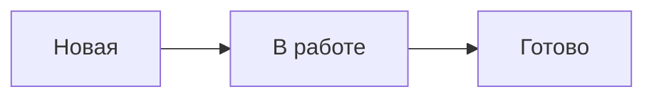

# Скриншоты и схемы

Раздел отвечает на вопрос: когда добавлять изображения в документацию ДелоТрек и как их готовить, чтобы они помогали читателю и не устаревали. Правила подробно раскрывают требование [ОФ-8](text-formatting.md#of-8).

## ИЗ-1. Добавляем изображение, только когда без него не обойтись {#iz-1}

Скриншот нужен, если элемент интерфейса трудно найти по описанию или если читатель должен сверить результат. Не вставляем скриншот к каждому шагу инструкции: каждое изображение придётся обновлять после изменения интерфейса.

<!-- textlint-disable -->

| Не пишем | Пишем |
| --- | --- |
| Скриншот после каждого из пяти шагов | Один скриншот формы, где много полей |
| Скриншот кнопки «Сохранить» | Нажмите **Сохранить** — без изображения |

<!-- textlint-enable -->

Проверка: ревью.

## ИЗ-2. Показываем только нужную область {#iz-2}

- Обрезаем скриншот до той части окна, о которой идёт речь. Не показываем рабочий стол, вкладки браузера и панели задач.
- Делаем скриншоты в окне шириной 1280 px и светлой теме — так все изображения в документации выглядят одинаково.
- На экране с высокой плотностью пикселей (Retina) файл получится шириной 2560 px. Сохраняем его как есть: сайт уменьшит изображение до нужной ширины, и оно останется чётким.
- Масштаб интерфейса — 100 %.

Проверка: ревью.

## ИЗ-3. Выделяем главное одинаково {#iz-3}

- Важный элемент обводим красной рамкой толщиной 2 px со скруглёнными углами. Цвет не единственный признак выделения: если выделенных элементов несколько, рядом с каждой рамкой ставим номер.
- Если на скриншоте несколько шагов, ставим номера в красных кружках и ссылаемся на них в тексте: «введите название (1) и выберите исполнителя (2)».
- Не используем стрелки разных цветов, размытие всего фона и надписи поверх интерфейса.

Проверка: ревью.

## ИЗ-4. Убираем персональные данные {#iz-4}

На скриншотах используем тестовую учётную запись и вымышленные данные: «Анна Смирнова», «Подготовить отчёт». Реальные имена, адреса почты, токены и номера телефонов закрашиваем сплошной заливкой, а не размытием — размытый текст иногда можно восстановить.

Проверка: ревью.

## ИЗ-5. Подписываем изображения и храним их рядом с документом {#iz-5}

- У каждого изображения есть альтернативный текст, который описывает, что на нём важно.
- Файлы храним в папке `img` рядом с документом. Имя файла — латиницей в kebab-case и описывает содержание: `task-create-form.png`, а не `screenshot-1.png`.
- Формат: PNG для скриншотов, SVG для схем. Размер файла — не больше 500 КБ: тяжёлые изображения замедляют загрузку страницы. Перед коммитом проверяем размер командой `find docs -name '*.png' -size +500k`.

Проверка: линтер (альтернативный текст), ревью.

## ИЗ-6. Схемы рисуем кодом {#iz-6}

Схемы процессов и архитектуры делаем в Mermaid прямо в Markdown, а не картинкой из графического редактора. Такую схему можно поправить в Pull Request и увидеть изменения в истории Git.

````markdown

````

Проверка: ревью.

## ИЗ-7. Обновляем изображения вместе с интерфейсом {#iz-7}

Если изменение интерфейса затрагивает скриншот, обновляем его в том же Pull Request, что и текст. В описании Pull Request перечисляем обновлённые изображения.

Проверка: ревью.
